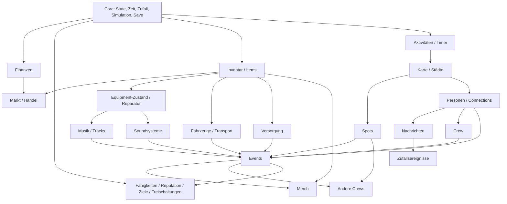

# 01 – Analyse des Konzepts

## Worum geht es?

TEKK LIFE ist eine Management-Simulation über eine fiktive Underground-Tekno-/Freetekk-Szene. Der Spieler startet mit 500 €, einem Smartphone und einem kleinen Zimmer und baut über Wochen und Monate ein eigenes Netzwerk auf: Leute, Spots, Equipment, Tracks, Soundsysteme, Crews, Events, Merch – bis hin zu mehreren Städten, Label und Festivals.

Das Spiel ist kein Idle-Game. Zahlen steigen, aber das Spiel lebt von **Entscheidungen**, **Entdeckungen** und **Verknüpfungen zwischen Systemen**.

## Die drei Säulen

| Säule | Bedeutung | Konkrete Mechaniken |
|---|---|---|
| **Entdecken** | Die Welt ist nie komplett sichtbar. | Nebel auf der Karte, versteckte Spots, Leute, die andere Leute kennen, Gerüchte, seltene Gebrauchtgeräte, freischaltbare Systeme, neue Städte |
| **Entscheiden** | Jede Ressource ist knapp, es gibt immer mehrere sinnvolle Optionen. | Nachrichten mit Antwortoptionen, Handeln auf dem Gebrauchtmarkt, Event-Planung (Eintritt, Werbung, Datum), Crew-Zusammenstellung, Investieren vs. Sparen |
| **Verbinden** | Systeme füttern sich gegenseitig. | Connection → DJ → Veranstalter → Spot → größeres Event → Reputation → bessere Connections → günstigere Lieferanten → mehr Gewinn → größeres Soundsystem |

## Spielschleifen

Das Spiel hat vier ineinandergreifende Schleifen. Auf jeder Ebene soll es jederzeit mehrere sinnvolle Dinge gleichzeitig zu tun geben.

1. **Mikro (Sekunden – 5 Minuten):** Nebenjob starten, Kleinanzeigen checken, jemandem schreiben, einen Bezirk erkunden, Equipment kaufen/verkaufen.
2. **Meso (10 Minuten – 4 Stunden):** Track produzieren, Spot checken, Event planen und vorbereiten, Crew aufbauen, Soundsystem zusammenstellen, Merch produzieren.
3. **Makro (Tage – Wochen):** Reputation-Stufen, neue Event-Formate, Vehicles, Lager, Label, zweite Stadt, mehrere Soundsysteme.
4. **Meta (Monate):** Festivals, eigene Locations, mehrere Crews und Städte, seltene Geräte, Vermächtnis/Prestige mit neuen Startszenarien.

Wichtig: Keine Schleife darf den Spieler zwingen, untätig zu warten. Timer laufen parallel in getrennten **Kanälen** (Job, Erkundung, Studio, Werkstatt, Besorgungen, Event-Vorbereitung). Während ein Track produziert wird, kann man gleichzeitig erkunden, jobben, schreiben und handeln.

## Spielwege (keiner ist „der beste“)

Jeder Weg hat eine eigene **Fähigkeit** des Spielers, eigene Freischaltungen und eigene Einnahmequellen. Die Wege überschneiden sich absichtlich, damit Mischformen entstehen.

| Weg | Fähigkeit | Fokus | Eigene Einnahmen (später) | Braucht von anderen Wegen |
|---|---|---|---|---|
| A – Producer | Produktion | Geräte, Tracks, Releases, Label | Releases, Streams, Gagen als Live-Act | Connections zu DJs/Labels |
| B – Soundsystem | Technik | Subs, Tops, Endstufen, Strom, Transport | Systemverleih, Technik-Jobs | Spots und Veranstalter, die das System brauchen |
| C – Veranstalter | Organisation | Events, Crew, Versorgung, Werbung | Eintritt, Bar | Soundsystem (eigen oder geliehen), DJs |
| D – Netzwerk | Netzwerk | Connections, Vermittlung, Spots, Kooperationen | Vermittlungsprovisionen, Kooperations-Anteile | Reputation aus Events |
| E – Merch/Business | Business | Designs, Produktion, Lager, Marke | Merch-Verkauf, Onlineshop (passiv) | Marke aus Events und Tracks |
| F – Mischung | alle | alles | alles | – |

Konsequenzen für das Design:

- **Freischaltungen** haben gemischte Bedingungen (Fähigkeit + Reputation + Entdeckungen + Connections), nicht nur eine Zahl.
- **Jobs** zahlen nicht nur Geld, sondern geben Fähigkeits-XP und führen zu Leuten – schon der Nebenjob ist eine Weg-Entscheidung.
- **Events** lassen sich auf jedem Weg machen: Der Producer spielt seine Tracks und bucht ein fremdes System, der Soundsystem-Spieler vermietet sich an Veranstalter, der Netzwerker organisiert Kooperationen.

## Startsituation

- 500 € Bargeld, einfaches Smartphone, billige Kopfhörer, kleines Zimmer (begrenzter Stauraum)
- 2 Connections (ein Techniker/Veranstalter, eine befreundete DJane)
- keine Crew, kein Soundsystem, keine bekannte Location, Reputation „Unbekannt“

Der Anfang fühlt sich klein an: Flyer verteilen, Thekenschicht, ein gebrauchter Drumcomputer, der erste Spot im Gewerbegebiet. Delegation kommt erst mit der Crew.

## Glaubwürdige Wirtschaft

- Gebrauchtmarkt ist zentral: zufällige Angebote mit Zustand, Verhandeln, Schnäppchen und Abzocke.
- Laufende Kosten wachsen mit dem Besitz (Lager, Fahrzeuge, Crew-Gagen) – Besitz ist eine Entscheidung.
- Skalierung über Größenordnungen: Nebenjob (25–200 €), erste Events (hunderte €), etablierte Events (zehntausende €), Festivals und mehrere Städte (Millionen). Langzeit-Senken: große Systeme, Immobilien, Festivals, Label, seltene Geräte, Prestige.

## Abhängigkeiten zwischen Systemen

Daraus folgt die Reihenfolge der Entwicklung: zuerst Core (Zeit, Simulation, Save), dann die „Primitive“ (Geld, Inventar, Fähigkeiten), dann Welt (Karte, Spots, Personen), dann Produktion (Equipment, Musik, Systeme), dann das System, das alles zusammenführt (Events), dann Ausbau (Merch, Rivalen, Zufall, Städte, Endgame).

## Risiken

| Risiko | Auswirkung | Gegenmaßnahme |
|---|---|---|
| **Scope-Explosion** | Viele halbfertige Systeme | Phasen mit Abnahmekriterien; vertikaler Slice zuerst; jede Phase vollständig getestet |
| **Content-Abhängigkeit** | Spiel wirkt leer, Logik hart verdrahtet | Alle Inhalte als typisierte Daten, generische Bedingungs-/Effekt-Sprache, Content-Validierung in Tests |
| **Save-Kompatibilität** | Neue Phasen zerstören alte Spielstände | Versionierte Saves, Migrationen, automatisches Auffüllen neuer State-Bereiche, Backup-Slot, Export/Import |
| **Offline-Fortschritt inkonsistent** | Online und offline liefern andere Ergebnisse, Exploits | Eine einzige ereignisgesteuerte Simulation (`advanceTo`) für beides; Test, dass 1 großer Schritt = viele kleine Schritte |
| **Zeitmanipulation** | Uhr vorstellen = Cheat | Offline-Deckel für passive Einnahmen; Rückwärtssprünge der Uhr werden ignoriert |
| **Balancing** | Zu schnell durch oder zu zäh | Datengetriebene Werte, Wirtschafts-Simulationstests, viele kleine/mittlere/große Ziele |
| **Wirtschafts-Exploits** | Kaufen/Verkaufen-Schleifen | Verkaufspreis immer unter Kaufpreis, Markt-Angebote zufällig und einmalig, Tests |
| **Mobile-UI überfüllt** | Unspielbar auf dem iPhone | Mobile-first, große Touch-Ziele, Bottom-Navigation, Tabs statt langer Seiten, Playwright-Screenshots im iPhone-Viewport |
| **Monolith-Dateien** | Unwartbar | Ein Ordner pro System; UI, Logik und Daten strikt getrennt |
| **Platzhalter-Funktionen** | Frust | Navigation zeigt nur fertige Systeme; gesperrte Systeme sind deaktiviert und nennen die Bedingung |
| **Browser-Speicher (iOS)** | Safari kann Website-Daten löschen | Export/Import als Text und Datei; später optional Cloud-Sync oder native Hülle (Capacitor) |
| **Performance bei großer Welt** | Ruckeln, langsames Speichern | Zustandsbegrenzung (Log-Ringpuffer), tägliche statt sekündliche Weltsimulation, Simulation ohne React |

## Was zuerst gebraucht wird

1. **Simulationskern** (Zeit, Timer, Zufall, Ereignisschleife) – alles andere hängt davon ab.
2. **Save/Load + Offline** – muss ab Tag 1 stabil sein, sonst wird jede spätere Phase riskant.
3. **Primitive:** Geld/Ledger, Inventar, Fähigkeiten/Reputation, Benachrichtigungen, Bedingungen/Effekte.
4. **UI-Grundgerüst:** Navigation, Dashboard, Designsystem.

Das ist genau Phase 1.
